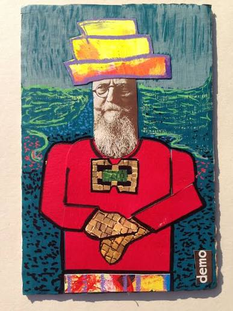

# Activos alternativos: arte y coleccionismo

Esto es menos teoría y más marco para decidir mejor antes de comprar una pieza (por ejemplo, en una plataforma de subastas como Catawiki).

*Técnica mixta y collage — el mismo principio de "originalidad + procedencia" que aplica a cualquier obra que valores como activo.*

## Por qué el arte es un activo distinto

- **Iliquidez**: no hay un mercado continuo como la bolsa. Vender una
  pieza puede tardar meses o años y depende de encontrar comprador
  interesado, no de pulsar un botón.
- **Valoración subjetiva**: el "precio" de una obra es lo que alguien
  esté dispuesto a pagar en ese momento, no un precio de mercado
  objetivo como el de una acción cotizada.
- **Riesgo de autenticidad**: especialmente en obra gráfica (grabados,
  litografías) de artistas muy falsificados como Dalí, la procedencia y
  la certificación importan tanto como la obra en sí. Antes de comprar,
  verificar: certificado de autenticidad, número de edición si es obra
  gráfica seriada, y reputación del vendedor/casa de subastas.
- **Costes de transacción altos**: comisiones de casas de subasta
  (compra y venta), seguros, conservación — reducen el retorno neto
  frente a lo que sugiere la subida de precio "de catálogo".

## Cómo encaja en una cartera

No es un sustituto de la inversión líquida (fondos, acciones): es un
activo satélite adicional, fuera del ahorro mensual de inversión, que
diversifica por tener una correlación distinta con los mercados
financieros. No debería depender de él para objetivos con fecha fija
(como financiar el negocio en 3-5 años) precisamente por la iliquidez.

## Catawiki y plataformas similares

Ventaja: acceso a piezas sin pasar por una casa de subastas tradicional,
comisiones más bajas. Riesgo: menor filtro de autentificación que
Christie's/Sotheby's — la verificación previa a pujar recae más en el
comprador. Para piezas de valor medio (1.000-4.000€, un rango habitual para coleccionistas aficionados), es un
mercado razonable si se hace la diligencia debida; para piezas de mayor
valor, las casas tradicionales ofrecen más garantías.

## Ejemplo numérico: el precio de catálogo no es el coste real

Una obra gráfica de Dalí con "precio de martillo" (lo que pagas en la
puja) de 2.000€ en Catawiki tiene costes adicionales habituales que hay
que sumar antes de comparar con cualquier otra inversión:

| Concepto | Importe aproximado |
|---|---|
| Precio de martillo (puja ganadora) | 2.000€ |
| Comisión de comprador (~9-25% según categoría/plataforma) | ~300€ |
| IVA sobre la comisión (y a veces sobre el total, según régimen) | ~60-100€ |
| Envío asegurado + embalaje especializado | ~50-150€ |
| Enmarcado/conservación profesional | ~100-300€ |
| **Coste real total** | **~2.500-2.850€** |

El "precio" que ves en la puja es solo el punto de partida — el coste
real puede ser 25-40% superior. Para que esa pieza sea una buena
inversión, su valor de reventa futura (menos las mismas comisiones, esta
vez de venta) tiene que superar ese coste real total, no el precio de
martillo — un cálculo que muchas veces se pasa por alto en la emoción de
ganar una puja.

## Enlaces para profundizar

- [Artprice — índices de mercado del arte](https://www.artprice.com/)
- [Art Basel & UBS — Art Market Report (informe anual)](https://www.artbasel.com/about/initiatives/the-art-market)
- [Catawiki — guía de autenticidad](https://www.catawiki.com/es/c/authenticity)
